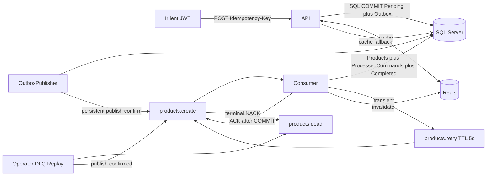

# Demonstracja 66 — podręcznik samodzielnego przeprowadzenia 9 testów

**WWSI · .NET 10 · EF Core 10 · SQL Server 2022 · RabbitMQ · Redis · PowerShell 7 · Docker Compose**  
Wydanie: 13 listopada 2026.

> Wszystkie scenariusze uruchamiaj **wyłącznie na osobnym laboratorium**. Testy zatrzymują usługi, a test 8 wykonuje SIGKILL Workera. **Nigdy nie uruchamiaj `docker compose down -v`** — usuniesz trwałe wolumeny SQL i RabbitMQ.

## 1. Cele i organizacja

Celem jest wykazanie: trwałości SQL Outbox, eventual consistency, fallback Redis→SQL, obsługi awarii SQL, bounded retry, DLQ, idempotencji Workera, redelivery po COMMIT bez ACK oraz świadomego DLQ Replay.

Testy 1–3 wykonywane ręcznie; testy 4–9 korzystają z gotowych skryptów. **Test 9 wymaga poprawnego komunikatu pozostawionego przez test 6.** Historyczne wyniki zobacz w [RESULTS-2026-11-13.md](RESULTS-2026-11-13.md); własne notuj w [LAB-RESULTS-TEMPLATE.md](LAB-RESULTS-TEMPLATE.md).

## 2. Wymagania i instalacja

Wymagane: Windows 11 / PowerShell 7, Git, .NET SDK 10, Docker Desktop z kontenerami Linux i Compose v2, połączenie z internetem na pierwsze pobranie obrazów, wolne porty hosta `127.0.0.1:8080`, `127.0.0.1:15672`, `127.0.0.1:14353` i zasoby RAM/dysku dla SQL Server. Zawsze pracuj z katalogu `demonstracje/66_WebApiRabbitRedisSql`.

```powershell
$PSVersionTable.PSVersion
dotnet --version
docker compose version
docker info --format '{{.OSType}}'
git clone https://github.com/marcinpytlik/WWSI_CSharp.git
Set-Location .\WWSI_CSharp\demonstracje\66_WebApiRabbitRedisSql
if (-not (Test-Path .env)) { Copy-Item .env.example .env }
notepad .env
docker compose config --quiet
docker compose up -d sql rabbitmq redis
docker compose --profile setup run --rm db-init
docker compose up -d --build api worker
docker compose build dlq-replay
docker compose ps
```

Zmień przykładowe hasła i klucz JWT w lokalnym `.env`; nie udostępniaj go i nie commituj. Skonfiguruj `SQL_SA_PASSWORD`, `SQL_API_PASSWORD`, `SQL_WORKER_PASSWORD`, `RABBIT_USER`, `RABBIT_PASSWORD`, `JWT_SIGNING_KEY`, `JWT_ISSUER`, `JWT_AUDIENCE`. JWT key wymaga min. 32 bajtów UTF-8. `db-init` jest **jawnym jednorazowym provisioningiem**, nie krokiem restartu. Przy istniejącym wolumenie nie zmieniaj haseł SQL bez kontrolowanej rotacji.

Poczekaj na `healthy` dla SQL, RabbitMQ i Redis. API: http://localhost:8080; RabbitMQ UI: http://localhost:15672; SQL/SSMS: `localhost,14353`, baza `WwsiQueueCache`. Redis i Worker nie wystawiają portów na hosta.

### Obowiązkowy baseline

```powershell
dotnet test .\tests\QueueCacheDemo.Tests\QueueCacheDemo.Tests.csproj
.\scripts\Smoke-Test.ps1
docker compose ps
```

W referencyjnej wersji `24/24` xUnit i oba komunikaty:
```text
PASS: accepted -> idempotent -> completed -> MISS -> HIT -> tenant isolation
PASS: error contracts 400 / 409 / 404 / 401
```
Jeżeli baseline nie przejdzie, nie rozpoczynaj awarii kontrolowanych.

## 3. Architektura i semantyka



HTTP `202 Accepted` oznacza **atomowy zapis w SQL** `OperationStatuses` i `OutboxMessages`, ale **nie potwierdza**, że produkt został już utworzony lub że broker odebrał wiadomość. Relay publikuje później. Worker zapisuje w jednej transakcji `Products`, `ProcessedCommands` i status `Completed`, a potem wykonuje RabbitMQ ACK. `GET /operations/{guid}` pokazuje Pending/Completed/Failed. `GET /products/{guid}` korzysta z Redis cache-aside (TTL 15 s), potem SQL. `/health/live` nie bada zależności, `/health/ready` bada SQL, Redis i RabbitMQ.

Kolejki: `products.create`, `products.retry` (TTL 5000 ms, maks. 3 ponowienia po pierwszej próbie), `products.dead`. Deduplikacja przez `ProcessedCommands.Id`; aplikacja używa kont o ograniczonych uprawnieniach `wwsi_api` i `wwsi_worker`, nie konta `sa`.

## 4. Pomocnicze komendy i ręczne testy

```powershell
docker compose ps
docker compose logs --tail=100 api worker
docker compose exec rabbitmq rabbitmqctl list_queues name messages_ready messages_unacknowledged consumers
Invoke-WebRequest http://localhost:8080/health/ready -SkipHttpErrorCheck
```

Przygotuj funkcje do **ręcznych testów 1–3** w tej samej sesji PowerShell:

```powershell
$BaseUrl = "http://localhost:8080"
$token = .\scripts\New-DemoJwt.ps1
$auth = @{ Authorization = "Bearer $token" }

function New-LabOperation {
    param([string]$Name = "ManualLab")
    $h = @{ Authorization = "Bearer $token"; "Idempotency-Key" = [guid]::NewGuid().ToString() }
    $body = @{ name = "$Name-$([guid]::NewGuid().ToString('N'))"; price = 42.50 } | ConvertTo-Json
    Invoke-RestMethod "$BaseUrl/products" -Method Post -Headers $h -Body $body -ContentType "application/json"
}

function Wait-LabOperation {
    param([Parameter(Mandatory)][guid]$OperationId, [int]$Seconds = 120)
    $end = [DateTime]::UtcNow.AddSeconds($Seconds)
    do {
        $s = Invoke-RestMethod "$BaseUrl/operations/$OperationId" -Headers $auth
        Write-Host "$OperationId -> $($s.status) / $($s.errorCode)"
        if ($s.status -in @("Completed","Failed")) { return $s }
        Start-Sleep -Seconds 2
    } while ([DateTime]::UtcNow -lt $end)
    throw "Timeout: $OperationId"
}
```

### Test 1 — RabbitMQ offline / Outbox

```powershell
docker compose stop rabbitmq
$op1 = New-LabOperation "RabbitOutage"
$op1
Invoke-WebRequest "$BaseUrl/health/ready" -SkipHttpErrorCheck
docker compose start rabbitmq
Wait-LabOperation -OperationId $op1.operationId
```

**PASS:** POST podczas awarii zwraca 202 i `operationId`; po przywróceniu brokera i reconnect kończy się `Completed`. Przy przerwaniu: `docker compose start rabbitmq`, sprawdź Outbox i logi.

### Test 2 — Worker offline / eventual consistency

```powershell
docker compose stop worker
$op2 = New-LabOperation "WorkerOutage"
Invoke-RestMethod "$BaseUrl/operations/$($op2.operationId)" -Headers $auth
docker compose start worker
Wait-LabOperation -OperationId $op2.operationId
```

**PASS:** najpierw `Pending`, po starcie Workera `Completed`. Przy przerwaniu: `docker compose start worker`.

### Test 3 — Redis offline / SQL fallback

```powershell
$op3 = New-LabOperation "RedisOutage"
Wait-LabOperation -OperationId $op3.operationId
docker compose stop redis
$rOffline = Invoke-WebRequest "$BaseUrl/products/$($op3.productId)" -Headers $auth
$rOffline.StatusCode
$rOffline.Headers["X-Cache"]
docker compose start redis
$r1 = Invoke-WebRequest "$BaseUrl/products/$($op3.productId)" -Headers $auth
$r2 = Invoke-WebRequest "$BaseUrl/products/$($op3.productId)" -Headers $auth
$r1.Headers["X-Cache"]
$r2.Headers["X-Cache"]
```

**PASS:** Redis offline => HTTP 200 i `MISS` (SQL); po Redis healthy => `MISS` i `HIT`. Przy opóźnionym reconnect powtórz dwa GET. Przy przerwaniu: `docker compose start redis`.

## 5. Zautomatyzowane scenariusze 4–9

### Test 4 — SQL Server offline / HTTP 503

```powershell
.\scripts\Test-SqlOutage.ps1
```

Skrypt zatrzymuje SQL, sprawdza `/health/live = 200`, `/health/ready = 503` i `POST /products = 503`, a w `finally` przywraca SQL. **PASS:** wszystkie trzy statusy i SQL `healthy`. Przy nieudanym odtworzeniu: `docker compose start sql`. Czasy ~5 s z przebiegu referencyjnego nie są gwarantowanym SLA.

### Test 5 — transient error / bounded retry

```powershell
.\scripts\Test-Retry.ps1
```

Skrypt tymczasowo aktywuje `Chaos__EnableRetryProbe=true` dla produktu `RetryProbe-*`, generuje `TimeoutException` na pierwszej dostawie, weryfikuje `products.retry` z TTL 5 s, potem `Completed` i przywrócenie Workera. **PASS:** `PASS: transient failure -> products.retry -> completed (same operation)`.

### Test 6 — DLQ dla błędów trwałych i wyczerpanych retry

```powershell
.\scripts\Test-Dlq.ps1
```

A: błędny JSON trafia natychmiast do DLQ. B: `DeadLetterProbe-*` wymusza 4 dostawy (pierwsza + 3 retry), potem `Failed/RETRIES_EXHAUSTED` i DLQ. **PASS:**

```text
PASS: malformed JSON -> immediate DLQ
PASS: 3 retries -> Failed/RETRIES_EXHAUSTED -> DLQ
DLQ final: ... (baseline: ...; expected delta: +2)
Worker configuration restored
```

**Zanotuj OperationId z B**: jest potrzebny w teście 9. Nie usuwaj komunikatów z `products.dead`, bo replay będzie niemożliwy.

### Test 7 — Idempotent Consumer

```powershell
.\scripts\Test-IdempotentConsumer.ps1
```

Oryginalny Payload z SQL Outbox jest dostarczany jeszcze dwa razy. **PASS:**

```text
SQL baseline: Products=1, ProcessedCommands=1, CompletedStatus=1
Delivery 2 -> Products=1, ProcessedCommands=1, Completed=1
Delivery 3 -> Products=1, ProcessedCommands=1, Completed=1
PASS: 3 deliveries -> exactly 1 Product, 1 ProcessedCommand, 1 Completed operation
```

### Test 8 — Crash po SQL COMMIT, przed RabbitMQ ACK

```powershell
.\scripts\Test-CommitAckCrash.ps1
```

Skrypt aktywuje punkt `POST_COMMIT_PRE_ACK_PAUSE` dla `CrashProbe-*`, potwierdza SQL COMMIT, wykonuje SIGKILL Workera, wznawia go bez chaos i weryfikuje `redelivered=True`. **PASS:**

```text
Before crash : Products=1, ProcessedCommands=1, Completed=1
PASS: SQL COMMIT persisted; RabbitMQ ACK deliberately paused
Worker terminated using SIGKILL after SQL COMMIT
After redelivery : Products=1, ProcessedCommands=1, Completed=1
PASS: COMMIT -> SIGKILL before ACK -> RabbitMQ redelivery -> exactly one SQL business effect
```

Jeżeli nie ma markera COMMIT, nie wymuszaj ręcznego SIGKILL.

### Test 9 — ręcznie zatwierdzany DLQ Replay

```powershell
# Preview nie usuwa wiadomości:
.\scripts\Test-DlqReplay.ps1

# ZASTĄP GUID własnym OperationId z testu 6:
.\scripts\Test-DlqReplay.ps1 -OperationId "00000000-0000-0000-0000-000000000000"
```

Warunki: istniejący poprawny `DeadLetterProbe-*` w DLQ, SQL `Failed/RETRIES_EXHAUSTED`, brak Product i ProcessedCommands, Worker z `Chaos__EnableDlqProbe=false`. Operator wpisuje dokładnie `REPLAY <rzeczywisty-GUID>`. Narzędzie wykonuje `PUBLISH_CONFIRMED`, dopiero potem `SOURCE_ACKED`, a Worker osiąga `Completed` przy Products=1 i ProcessedCommands=1. Nie replayuj błędnego JSON. Przy niepewnym potwierdzeniu publikacji **nie ponawiaj ślepo replay** — możliwy jest duplikat.

## 6. Zapytania DBA w SQL Server

Uruchom w SSMS na `localhost,14353` w bazie `WwsiQueueCache`.

```sql
USE WwsiQueueCache;
GO
SELECT TOP (30) Id AS OperationId, ProductId, Status, ErrorCode,
       CreatedAtUtc, UpdatedAtUtc
FROM dbo.OperationStatuses ORDER BY CreatedAtUtc DESC;

SELECT TOP (30) OperationId, CreatedAtUtc, PublishedAtUtc, LeaseOwner, LeaseUntilUtc
FROM dbo.OutboxMessages ORDER BY CreatedAtUtc DESC;

SELECT TOP (30) Id AS ProductId, PrincipalId, Name, Price
FROM dbo.Products ORDER BY CreatedAtUtc DESC;

SELECT TOP (30) Id AS OperationId, CompletedAtUtc
FROM dbo.ProcessedCommands ORDER BY CompletedAtUtc DESC;

SELECT COUNT_BIG(*) AS Unpublished, MIN(CreatedAtUtc) AS OldestUnpublishedUtc
FROM dbo.OutboxMessages WHERE PublishedAtUtc IS NULL;

SELECT Status, ErrorCode, COUNT_BIG(*) AS Operations
FROM dbo.OperationStatuses GROUP BY Status, ErrorCode;
```

Dla pojedynczego OperationId zamień placeholder:

```sql
USE WwsiQueueCache;
GO
DECLARE @OperationId uniqueidentifier = '00000000-0000-0000-0000-000000000000';
SELECT o.Id, o.Status, o.ErrorCode, o.ProductId,
       CASE WHEN p.Id IS NULL THEN 0 ELSE 1 END AS ProductPresent,
       CASE WHEN pc.Id IS NULL THEN 0 ELSE 1 END AS ProcessedPresent
FROM dbo.OperationStatuses AS o
LEFT JOIN dbo.Products AS p ON p.Id = o.ProductId
LEFT JOIN dbo.ProcessedCommands AS pc ON pc.Id = o.Id
WHERE o.Id = @OperationId;
```

`PublishedAtUtc` potwierdza publikację do brokera, nie biznesowe Completed. Stan Pending może wynikać z brakującego brokera, Workera albo awarii SQL.

## 7. Diagnostyka, odzyskanie i kryteria końcowe

```powershell
docker compose ps
docker compose logs --tail=100 api worker
docker compose logs --tail=100 sql rabbitmq redis
docker compose exec rabbitmq rabbitmqctl list_queues name messages_ready messages_unacknowledged consumers
Get-ChildItem Env:CHAOS_ENABLE* -ErrorAction SilentlyContinue
```

| Objaw | Kontrola / działanie |
|---|---|
| SQL nie jest healthy | `docker compose logs sql`, pamięć, `docker compose start sql` |
| HTTP 401 | nowy `New-DemoJwt.ps1`, issuer/audience/exp |
| HTTP 409 | ten sam Idempotency-Key z innym JSON; nowy klucz dla nowej operacji |
| HTTP 503 | przywróć zależności; ten sam klucz i payload do retry tego samego POST |
| Długie Pending | Outbox, kolejki, logi Workera, SQL |
| Brak MISS/HIT | Redis, health, TTL/reconnect, powtórz GET |
| Test 7 błąd `sqlcmd -h/-y 0` | `git pull`: poprawiona wersja rozdziela opcje |
| Test 8 brak markera COMMIT | `docker compose up -d --build worker`; nie zabijaj Workera ręcznie |
| Test 9 brak GUID | sprawdź DLQ (limit 100 komunikatów), status SQL i czy nie był już odtworzony |

Po przerwaniu skryptu sprawdź, czy zmienne `CHAOS_ENABLE_RETRY_PROBE`, `CHAOS_ENABLE_DLQ_PROBE` i `CHAOS_ENABLE_POST_COMMIT_PAUSE` nie są true. Przywróć usługi:

```powershell
docker compose start sql rabbitmq redis
docker compose up -d --no-deps --force-recreate worker
docker compose ps
.\scripts\Smoke-Test.ps1
dotnet test .\tests\QueueCacheDemo.Tests\QueueCacheDemo.Tests.csproj
```

Nie czyść DLQ, nie usuwaj wolumenów. Przed zakończeniem wszystkie kontenery muszą wrócić do pracy (SQL, Redis i RabbitMQ healthy), Smoke-Test musi zakończyć się PASS, a każdy eksperyment musi mieć wpisaną ocenę PASS/FAIL w karcie pomiarowej.

## 8. Co udowadniają, a czego nie udowadniają testy?

Wyniki dowodzą działania mechanizmów w pojedynczym laboratorium: **at-least-once delivery** oraz idempotentny **efekt SQL**, nie dokładnie jednokrotne dostarczenie przez RabbitMQ. SQL i RabbitMQ nie mają tu wspólnej transakcji rozproszonej; możliwy jest duplikat po utraconym potwierdzeniu publikacji. Redis jest eventually consistent. Nie przetestowano produkcyjnego HA/DR, OIDC/JWKS, TLS, centralnego secret managera, quorum queues, load testów i mierzalnego RPO/RTO.

Więcej: [README](README.md), [OPERATIONS](OPERATIONS.md), [wyniki wykonanych eksperymentów](RESULTS-2026-11-13.md).
