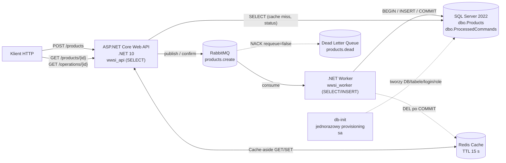
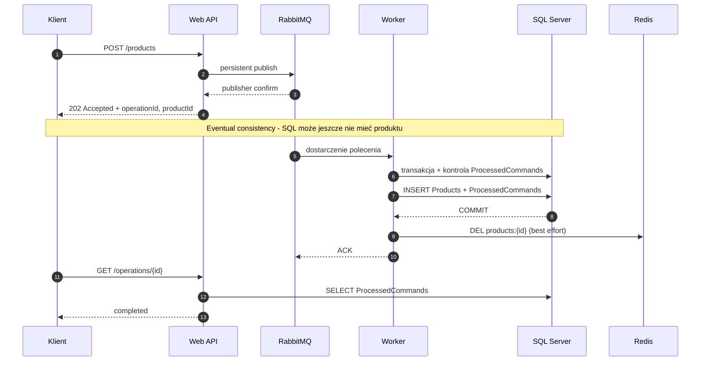
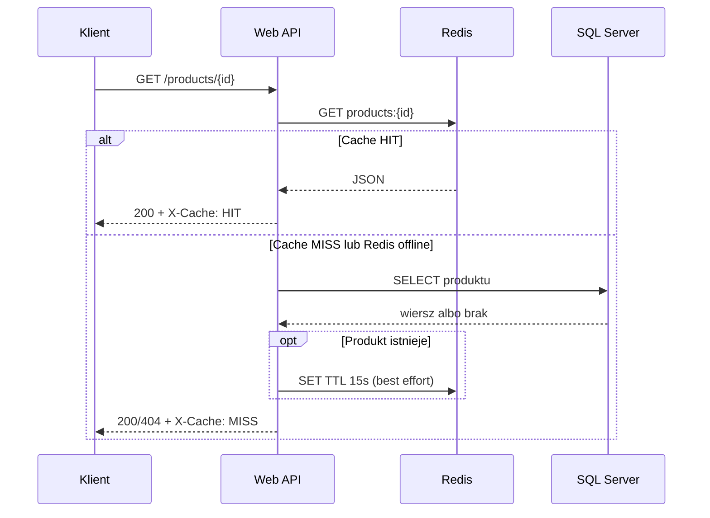

# 66 — ASP.NET Core Web API → RabbitMQ → SQL Server + Redis

.NET 10, EF Core 10, SQL Server 2022, RabbitMQ i Redis. Przykład pokazuje **eventual consistency**, **cache-aside**, **idempotentny Worker**, **minimalne uprawnienia do SQL Server** i **middleware obsługi wyjątków / logowania HTTP**.

## 1. Architektura



**SQL Server jest źródłem prawdy**. Redis przyspiesza GET, ale dane nie muszą być w nim obecne. API nie wykonuje INSERT. Jedynym podmiotem mającym uprawnienia DDL jest osobny etap `db-init`; konta aplikacyjne nie są `db_owner` ani `db_ddladmin`.

### Sekwencja zapisu



`202 Accepted` oznacza potwierdzenie publikacji, **nie** COMMIT. Przed zakończeniem pracy Workera `GET /products/{id}` może zwracać `404`, a `GET /operations/{id}`: `pending_or_unknown`. Worker używa `CreateExecutionStrategy().ExecuteAsync()` dla całej transakcji (z nowym `DbContext` podczas próby). Ponowne dostarczenie wiadomości z tym samym `OperationId` nie powoduje drugiego INSERT, bo `ProcessedCommands` jest zapisywane atomowo z `Products`.

### Sekwencja odczytu



Brak produktu nie jest cache'owany. Gdy Redis nie działa, GET korzysta z SQL Server. Inwalidacja po COMMIT jest best-effort, a TTL ogranicza czas życia wpisów; możliwe są chwilowe nieaktualne odczyty. Nie gwarantujemy `read-your-writes`.

## 2. Organizacja kodu

```text
66_WebApiRabbitRedisSql/
├── .env.example                   # przykład ustawień laboratorium
├── docker-compose.yml
├── sql/
│   ├── init-db.sh                 # uruchamiany tylko przez db-init
│   ├── 01-bootstrap.sql           # baza, tabele, loginy, role i GRANT
│   └── 02-verify-permissions.sql  # kontrola uprawnień
└── src/
    ├── Api/
    │   ├── Program.cs
    │   └── Middleware/
    │       ├── RequestLoggingMiddleware.cs
    │       └── ExceptionHandlingMiddleware.cs
    ├── Worker/
    │   └── Program.cs
    └── Shared/
        ├── Contracts/
        │   ├── CreateProduct.cs
        │   └── ProductDto.cs
        ├── Entities/
        │   ├── Product.cs
        │   └── ProcessedCommand.cs
        └── Data/
            ├── AppDbContext.cs
            └── Configuration/
                ├── ProductConfiguration.cs
                └── ProcessedCommandConfiguration.cs
```

`AppDbContext` używa `ApplyConfigurationsFromAssembly`, a mapowanie tabel/kolumn jest w klasach `IEntityTypeConfiguration<T>`. Modele domenowe nie zawierają kodu mapowania EF.

**Middleware API:** `RequestLoggingMiddleware` zapisuje metodę, ścieżkę, status, czas i trace ID (bez body ani haseł); `ExceptionHandlingMiddleware` rejestruje wyjątek w logach i zwraca ustandaryzowaną odpowiedź ProblemDetails HTTP 500 z `traceId`, bez stack trace dla klienta. Worker nie ma HTTP middleware — stosuje `ILogger`, obsługę wyjątków konsumenta, ACK/NACK i DLQ.

## 3. Minimalne uprawnienia SQL Server

| Zasób / uprawnienie | `wwsi_api` | `wwsi_worker` | `sa` wyłącznie `db-init` |
|---|:---:|:---:|:---:|
| `dbo.Products` — SELECT | Tak | Tak | Tak |
| `dbo.Products` — INSERT | Nie | Tak | Tak |
| `dbo.ProcessedCommands` — SELECT | Tak | Tak | Tak |
| `dbo.ProcessedCommands` — INSERT | Nie | Tak | Tak |
| UPDATE / DELETE / ALTER / CREATE TABLE | Nie | Nie | Tak |
| Tworzenie bazy, loginów, schematu | Nie | Nie | Tak |

Role: `role_api_reader` oraz `role_worker_writer`. Uprawnienia przyznane są **do konkretnych tabel**, nie przez szerokie `db_datareader`, `db_datawriter`, `db_owner` czy `db_ddladmin`. Inicjalizacja jest idempotentna i obsługuje **istniejącą bazę WwsiQueueCache** bez kasowania danych.

`db-init` uruchamia `sql/01-bootstrap.sql` i kończy się kodem 0; dopiero po jego poprawnym zakończeniu startują API i Worker. Worker **nie wywołuje `EnsureCreated`**. `sa` nie jest dostępne w konfiguracji API ani Workera.

Aby zweryfikować uprawnienia, w SSMS jako `sa` wykonaj `sql/02-verify-permissions.sql`. Oczekiwane wartości kolumn `ProductsSelect, ProductsInsert, CommandsSelect, CommandsInsert` to:
- `wwsi_api`: **1, 0, 1, 0**
- `wwsi_worker`: **1, 1, 1, 1**

Przy próbie `INSERT` z loginu API SQL powinien zwrócić odmowę uprawnień.

## 4. Uruchomienie Docker Compose

Wymagane: Docker Desktop, Docker Compose oraz zasoby na SQL Server.

**Pierwszy start lub aktualizacja poprzedniej wersji:**

```powershell
cd .\demonstracje\66_WebApiRabbitRedisSql
Copy-Item .env.example .env
docker compose config
docker compose up --build -d
docker compose ps -a
```

Użytkownik, który już posiada wolumen `sql_data` z wcześniejszych ćwiczeń, powinien pozostawić `SQL_SA_PASSWORD` zgodne z **dotychczasowym** hasłem `sa`. Nie uruchamiaj `docker compose down -v` — to skasowałoby bazę.

Wynik `docker compose ps -a`: `sql`, `rabbitmq` i `redis` mają status `healthy`; `db-init` ma `Exited (0)`; `api` i `worker` są `Up`. `docker compose config` pokazuje hasła w postaci jawnej — **nie publikuj jego wyniku w Internecie**.

Porty na hoście (tylko loopback): API `http://localhost:8080`; RabbitMQ UI `http://localhost:15672` (dane z `.env`); SQL Server `localhost,14353`. Redis jest tylko w sieci Compose.

Wszystkie hasła w `.env.example` są **wyłącznie do laboratorium**; plik `.env` jest ignorowany przez Git. W produkcji zastosuj sekret manager, odrębne konta i proces migracji, TLS, ograniczenia dostępu oraz rotację haseł. Użyte w labie `sqlcmd -v` może ujawnić hasła w argumentach procesu; nie należy przenosić tej metody na produkcję.

## 5. Test end-to-end

```powershell
Invoke-RestMethod http://localhost:8080/health

$body = @{ name = "EF Core 10"; price = 100.00 } | ConvertTo-Json
$response = Invoke-RestMethod -Method Post -Uri http://localhost:8080/products -ContentType application/json -Body $body
$response | Format-List # accepted

Invoke-RestMethod "http://localhost:8080/operations/$($response.operationId)"
# Po COMMIT: completed

$url = "http://localhost:8080/products/$($response.productId)"
1..2 | ForEach-Object {
    $r = Invoke-WebRequest -Uri $url
    [PSCustomObject]@{ Request = $_; Cache = $r.Headers["X-Cache"]; Body = $r.Content }
}
# MISS a potem HIT, jeśli TTL (15 s) nie wygasło
```

Logi: `docker compose logs --tail=100 api worker db-init`. Kolejki: `docker compose exec rabbitmq rabbitmqctl list_queues name messages_ready messages_unacknowledged consumers`.

## 6. Scenariusze awaryjne i ograniczenia

1. `docker compose stop worker`, wyślij POST i sprawdź status `pending_or_unknown`, następnie `docker compose start worker` i odczytaj status `completed`.
2. Zatrzymaj Redis, sprawdź odczyt GET z SQL Server, ponownie uruchom Redis.
3. Obejrzyj `products.dead`: na błędzie aplikacyjnym Worker wykonuje NACK bez requeue. **Automatyczny replay i trwały status failed nie są zaimplementowane.**
4. Powtórna dostawa **tego samego** `OperationId` jest idempotentna. Ponowny POST bez klucza idempotencji tworzy nowe ID i nowy produkt.
5. Po COMMIT, ale przed ACK, wiadomość może zostać ponownie dostarczona. Znacznik `ProcessedCommands` chroni przed powtórnym INSERT.
6. `/health` bada proces API, nie wszystkie zależności. Środowisko jest edukacyjne i nie jest projektem produkcyjnym.

## 7. Dotychczasowe wyniki

11.11.2026: przetestowano POST `accepted` → operacja `completed` → GET produktu `X-Cache: MISS` → `X-Cache: HIT` na wersji sprzed wydzielenia uprawnień. Po refaktoryzacji trzeba ponowić testy i potwierdzić zachowanie ról (wyniki nie są jeszcze zweryfikowane runtime).

## 8. Pytania do omówienia

Dlaczego API nie ma INSERT? Co daje oddzielenie `db-init` od Workera? Czy 202 oznacza COMMIT? Jak sprawdzić, że 404 nie pochodzi z cache? Dlaczego jawna transakcja musi być otoczona strategią EF Core? Jaki jest wpływ TTL i opóźnień kolejki na spójność odczytów?
