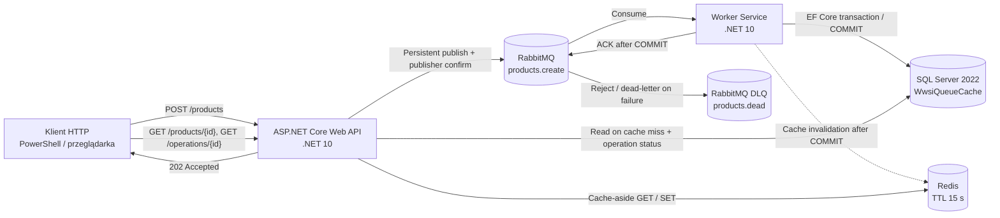
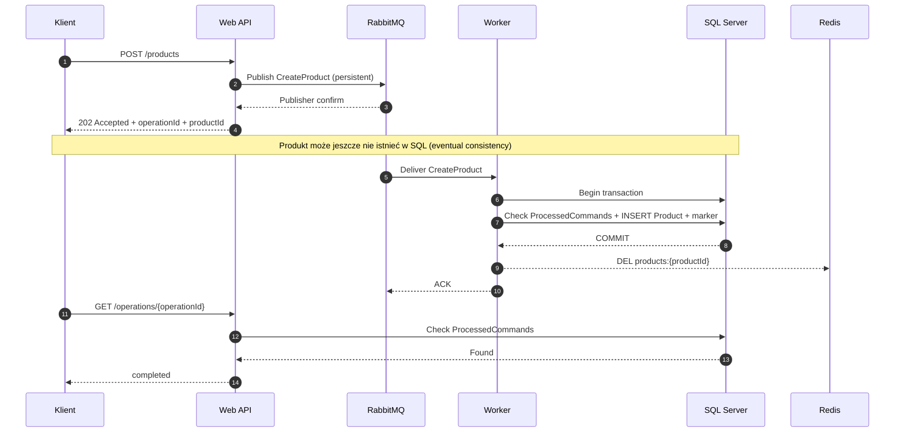
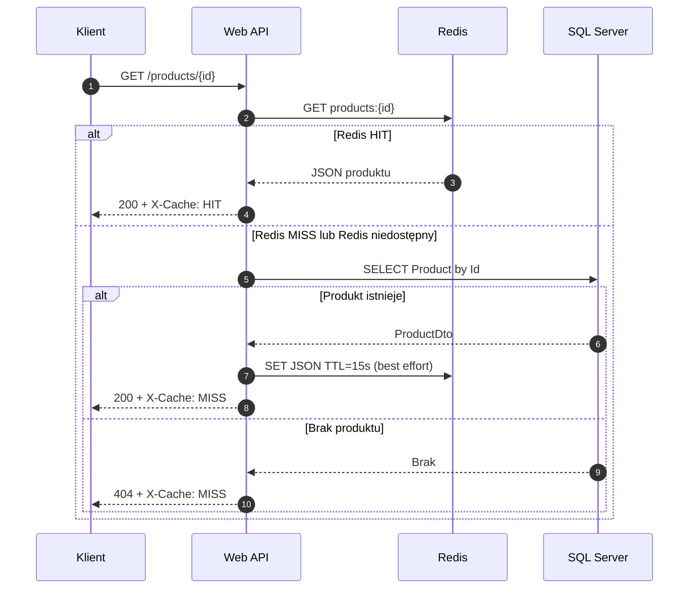

# 66 — Web API → RabbitMQ → SQL Server + Redis (Cache-Aside)

Demonstracja .NET 10: **asynchroniczne zapisy (eventual consistency)** oraz **odczyty z Redis Cache**. SQL Server to system of record. API nie zapisuje bezpośrednio do SQL.

## Architektura rozwiązania

### 1. Diagram komponentów (C4 — poziom kontenerów)



**Podział odpowiedzialności**

| Komponent | Rola | Stan / kontrakt |
|---|---|---|
| Klient | Wywołuje HTTP i sprawdza status operacji | POST, GET |
| Web API (`src/Api`) | Waliduje POST, publikuje komunikat; przy GET korzysta z cache-aside | Zwraca 202 po potwierdzeniu publikacji |
| RabbitMQ | Trwała kolejka poleceń zapisu | `products.create`; DLQ `products.dead` |
| Worker (`src/Worker`) | Pobiera polecenia i zapisuje produkt oraz znacznik obsłużenia | Manual ACK po SQL COMMIT |
| SQL Server | Źródło prawdy; przechowuje produkty i identyfikatory wykonanych operacji | `dbo.Products`, `dbo.ProcessedCommands` |
| Redis | Cache odczytowy, nie źródło prawdy | Klucz `products:{guid:N}`, TTL 15 s |

### 2. Sekwencja zapisu — eventual consistency



Odpowiedź **202 Accepted** informuje tylko o potwierdzeniu publikacji w RabbitMQ. Nie gwarantuje jeszcze wykonania transakcji SQL. `GET /operations/{id}` zwraca obecnie `completed` lub `pending_or_unknown`; drugi status nie rozróżnia oczekiwania, błędu i nieznanej operacji. Przed COMMIT `GET /products/{id}` może poprawnie zwrócić **404**.

RabbitMQ dostarcza wiadomości z semantyką **at-least-once**. Worker sprawdza `ProcessedCommands.Id` i zapisuje znacznik razem z produktem w transakcji; przy ponownym dostarczeniu z tym samym `OperationId` nie wykonuje ponownie INSERT. EF Core `SqlServerRetryingExecutionStrategy` obejmuje **całą transakcję** poprzez `CreateExecutionStrategy().ExecuteAsync()`, z nowym DbContext na próbę.

### 3. Sekwencja odczytu — cache-aside



Redis jest optymalizacją: podczas awarii Redis API próbuje odczytać SQL bez cache. **404 nie jest cache'owane**, żeby zaakceptowane, ale jeszcze niezapisane polecenia mogły być widoczne po COMMIT. Worker unieważnia odpowiedni klucz po transakcji; brak atomowości między SQL i Redis oznacza możliwe chwilowe nieaktualne odczyty (włącznie z wyścigiem cache miss vs COMMIT). TTL ogranicza czas utrzymania wpisu, lecz nie gwarantuje read-your-writes.

### 4. Infrastruktura Docker Compose

```text
                         Docker Compose network
┌────────────────────────────────────────────────────────────────────┐
│ api:8080 ───────── rabbitmq:5672 ───────── worker                  │
│    │                                       │                      │
│    ├───────────── redis:6379 ◄─────────────┤                      │
│    └───────────── sql:1433   ◄─────────────┘                      │
└────────────────────────────────────────────────────────────────────┘
host: 8080 → API; 15672 → RabbitMQ Management; 14353 → SQL 1433
Redis 6379 jest udostępniony wewnątrz sieci Compose, bez mapowania na hosta.
```

API i Worker mają osobne projekty i obrazy. `Shared` zawiera `Product`, `ProcessedCommand`, `CreateProduct`, `ProductDto` i `AppDbContext`. Worker tworzy schemat demonstracyjny przez `EnsureCreated` (wyłącznie lab). Healthcheck SQL używa zmiennej `$$MSSQL_SA_PASSWORD` w Compose, aby powłoka kontenera otrzymała `$MSSQL_SA_PASSWORD` i mogła odczytać hasło.

### 5. Awaria a spójność

| Sytuacja | Oczekiwane zachowanie w bieżącej implementacji |
|---|---|
| Worker zatrzymany | API może zwracać 202; wiadomości czekają w RabbitMQ; status `pending_or_unknown` |
| SQL niedostępny podczas obsługi | Worker zgłasza błąd; wiadomość może trafić do DLQ; brak automatycznego retry na poziomie wiadomości |
| Redis niedostępny podczas GET | API próbuje odczytu z SQL; wpis nie trafia do cache |
| Redis niedostępny po COMMIT | Worker loguje ostrzeżenie; ACK nadal jest wysyłany; ewentualny stary wpis wygaśnie według TTL |
| Worker zakończony po COMMIT, przed ACK | Broker może dostarczyć wiadomość ponownie; znacznik w SQL zapobiega ponownemu INSERT |
| Powtarzane POST tego samego żądania | Każdy POST generuje nowy OperationId i ProductId — **brak idempotency key po stronie API** |

**Granica dydaktyczna:** to działająca demonstracja, a nie gotowy wzorzec produkcyjny. Nie ma trwałego rejestru statusów pending/failed, procesu automatycznego replay z DLQ, transakcyjnego mechanizmu niezawodnej invalidacji ani osobnych kont o minimalnych uprawnieniach. `/health` potwierdza działanie procesu API, nie pełną gotowość zależności.

### 6. Wynik weryfikacji (11.11.2026)

Wykonany ręczny scenariusz potwierdził: POST zwraca `accepted`, późniejsze `GET /operations/{id}` zwraca `completed`, pierwszy GET produktu zwraca `X-Cache: MISS`, a kolejny `X-Cache: HIT`. Jest to test funkcjonalny, **nie** benchmark wydajności ani test odporności na awarie.

## Start

Wymagane: Docker Desktop z >= 4 GB RAM dostępnej dla SQL Server i Docker Compose.

1. Z katalogu tej demonstracji: `docker compose up --build -d`
2. Stan kontenerów: `docker compose ps`, logi: `docker compose logs -f api worker`
3. Swagger nie jest wymagany; endpoint health: `http://localhost:8080/health`.
4. RabbitMQ UI: `http://localhost:15672` (demo/demo).
5. SQL Server: localhost,14353, login sa, hasło **wyłącznie laboratoryjne** z compose.

### Windows PowerShell

```powershell
$body = @{ name = "Monitor"; price = 799.99 } | ConvertTo-Json
$r = Invoke-RestMethod -Method Post -Uri http://localhost:8080/products -ContentType application/json -Body $body
$r                       # 202 Accepted; operationId oraz productId
Invoke-RestMethod "http://localhost:8080/operations/$($r.operationId)"
Invoke-RestMethod "http://localhost:8080/products/$($r.productId)"
```

Przy pierwszym GET produkt może zwrócić 404, dopóki Worker nie zakończy transakcji: to zamierzone **eventual consistency**. Powtórz GET i porównaj nagłówek `X-Cache` (MISS/HIT). W API GET działa cache-aside z TTL 15 sekund. Brak rekordu nie jest cache'owany.

### Scenariusze badawcze

1. Wykonaj POST, następnie od razu GET oraz GET po przetworzeniu; sprawdź `202` i status operacji.
2. Powtórz GET: pierwszy powinien zwrócić MISS, kolejny HIT.
3. Zatrzymaj Worker (`docker compose stop worker`), wyślij kilka POST, sprawdź gotowe komunikaty w RabbitMQ, uruchom Worker i odczytaj dane.
4. Zatrzymaj Redis; GET korzysta awaryjnie z SQL Server. Przywróć Redis.
5. Sprawdź w SQL `dbo.Products` i `dbo.ProcessedCommands`, obserwując idempotentne przetwarzanie.

### Semantyka i ograniczenia

- API zwraca 202 dopiero po publisher confirm RabbitMQ; nie oznacza to zatwierdzenia rekordu w SQL.
- Worker używa manual ACK **po COMMIT**. Identyfikator operacji jest kluczem w tabeli `ProcessedCommands`; ponowna dostawa komunikatu nie tworzy drugiego produktu.
- W razie błędu przetwarzania komunikat jest odrzucany do DLQ `products.dead` (bez automatycznych retry w tym laboratorium). Operacja może pozostać niepotwierdzona, dopóki nie zostanie obsłużona ręcznie.
- Klucze Redis są usuwane po COMMIT. Inwalidacja nie jest transakcyjna z SQL; przy jej niepowodzeniu TTL ogranicza okres nieaktualności. Możliwy jest również wyścig między cache miss i zapisem. To **nie** zapewnia silnej spójności ani gwarantowanego read-your-writes.
- `GET /operations/{id}` zwraca `completed` lub `pending_or_unknown`; brak osobnej trwałej tabeli statusów poleceń oczekujących / odrzuconych.
- `EnsureCreated` zastosowano wyłącznie do demonstracji (nie do migracji produkcyjnych). Produkcyjnie wymagane: migracje, osobne konta SQL, TLS, sekrety, RBAC, health checks zależności, retry policy + DLQ/replay, obserwowalność i odporna invalidacja.
- Hasła w `docker-compose.yml` są przykładowe: **nie wdrażaj tego konfiguracji na produkcję**.

## Budowa bez Dockera

Rozwiązanie projektów pod `src` korzysta z nadrzędnych `Directory.Build.props` i `Directory.Packages.props` całego repozytorium. Lokalnie z katalogu repo: `dotnet build demonstracje/66_WebApiRabbitRedisSql/src/Api/Api.csproj` oraz analogicznie Worker.

## Warto omówić ze studentami

Co oznacza 202? Dlaczego ACK po COMMIT? Czym różni się cache miss od nieistniejącego rekordu? Jak działa at-least-once i idempotencja? Co się stanie gdy SQL zatwierdzi zmianę, ale Redis lub RabbitMQ są niedostępne?
