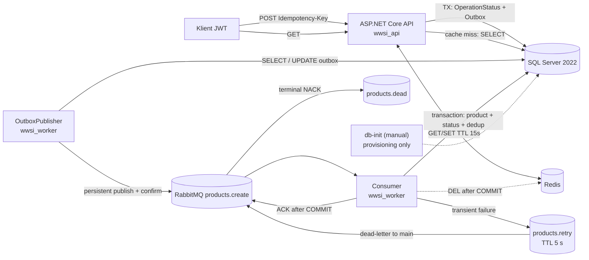

# 66 — Web API → SQL Outbox → RabbitMQ → Worker → SQL Server + Redis

**WWSI / .NET 10 / EF Core 10 / SQL Server 2022 / RabbitMQ / Redis**

Demonstracja architektury z **eventual consistency**, trwałym SQL Outbox, idempotencją HTTP oraz Workera, ograniczonym retry i Dead Letter Queue, bezpieczeństwem API, minimalnymi uprawnieniami SQL i OpenTelemetry.

> To wariant **production-oriented reference**, nie certyfikat gotowości produkcyjnej. Do wdrożenia wymagane są testy całego środowiska, decyzje HA/DR, rzeczywisty dostawca OIDC, TLS, zarządzanie sekretami oraz operatorzy/alerty (zob. [OPERATIONS.md](OPERATIONS.md)).

## Architektura docelowa



Każdy produkt posiada `PrincipalId`; SQL odczyt jest filtrowany według właściciela, a klucz Redis obejmuje identyfikator produktu i właściciela.

Kluczowa zmiana wobec pierwszej wersji: **202 Accepted oznacza COMMIT operacji i jej rekordu Outbox w SQL**, a nie potwierdzenie publikacji w RabbitMQ. Relay może opublikować polecenie później. Wiele replik relaya koordynuje pobieranie wiadomości przez odnawialny 60-sekundowy lease; po awarii i wygaśnięciu dzierżawy publikacja może się powtórzyć. Komunikat może przyjść więcej niż raz; Worker zapisuje `ProcessedCommands` w tej samej transakcji co produkt i status `Completed`.

```mermaid
sequenceDiagram
  participant U as Klient
  participant A as API
  participant D as SQL Server
  participant P as Outbox Publisher
  participant Q as RabbitMQ
  participant W as Worker
  participant R as Redis
  U->>A: POST /products + Bearer + Idempotency-Key
  A->>D: BEGIN; OperationStatus Pending + Outbox; COMMIT
  A-->>U: 202 Accepted (operationId, productId)
  P->>D: SELECT unpublished Outbox
  P->>Q: Publish persistent / confirm
  P->>D: Mark PublishedAtUtc
  Q->>W: Deliver
  W->>D: BEGIN; dedup + INSERT Product + Completed; COMMIT
  W->>R: DEL products:{id}
  W-->>Q: ACK
  U->>A: GET /operations/{id}
  A->>D: SELECT own operation
  A-->>U: Completed
  U->>A: GET /products/{id}
  A->>R: GET key
  alt MISS
    A->>D: SELECT product
    A->>R: SET with TTL
  end
  A-->>U: 200 + X-Cache MISS/HIT
```

### Struktura

```text
66_WebApiRabbitRedisSql/
├── src/
│   ├── Api/
│   │   ├── Middleware/ (request logging / centralized exceptions)
│   │   └── Program.cs (JWT, rate limit, endpoints, SQL Outbox)
│   ├── Worker/
│   │   └── Program.cs (OutboxPublisher + Consumer + bounded retry + metrics)
│   └── Shared/
│       ├── Contracts/
│       ├── Entities/ (Product, ProcessedCommand, OperationStatus, OutboxMessage)
│       └── Data/
│           ├── AppDbContext.cs
│           └── Configuration/ (IEntityTypeConfiguration<T>)
├── sql/
│   ├── 01-bootstrap.sql (provisioning, grants, schema)
│   └── 02-verify-permissions.sql
├── scripts/
│   ├── New-DemoJwt.ps1
│   └── Smoke-Test.ps1
├── tests/QueueCacheDemo.Tests/
├── .env.example
└── docker-compose.yml
```

## Minimalne uprawnienia SQL

`wwsi_api`: SELECT Products, SELECT/INSERT OperationStatuses, INSERT OutboxMessages. **Brak INSERT Products, UPDATE Outbox, DDL.**

`wwsi_worker`: SELECT/INSERT Products i ProcessedCommands, SELECT/UPDATE OperationStatuses i OutboxMessages. **Brak DDL i szerokich ról db_datawriter/db_owner.**

`sa` używane **tylko podczas świadomie uruchamianego provisioningu**; API i Worker nie mają jego hasła. Skrypt bootstrapowania nie zmienia haseł istniejących loginów. Przy istniejącym wolumenie zachowaj zgodność `.env` z hasłami kont SQL, albo przeprowadź osobną, kontrolowaną rotację.

## Pierwszy start / aktualizacja istniejącego laboratorium

Z poziomu `demonstracje/66_WebApiRabbitRedisSql`:

```powershell
git pull
if (-not (Test-Path .env)) { Copy-Item .env.example .env }
# Sprawdź wartości w .env. W istniejącym wolumenie pozostaw aktualne hasło sa.
docker compose config --quiet
docker compose up -d sql rabbitmq redis
docker compose --profile setup run --rm db-init
docker compose up -d --build api worker
docker compose ps
```

**Nie używaj `docker compose down -v`** — to usunie wolumeny SQL Server i RabbitMQ. RabbitMQ otrzymał w tej wersji nowy trwały wolumen `rabbitmq_data` oraz stałą nazwę węzła; **pierwsze przejście ze starego kontenera bez wolumenu wymaga sprawdzenia/eksportu zaległych wiadomości i DLQ przed jego odtworzeniem**. Stare wiadomości (z pierwszej wersji bez SQL Outbox) nie mają automatycznej drogi odtworzenia z SQL. Dane istniejące w SQL pozostają na wolumenie `sql_data`. `docker compose config` bez `--quiet` wypisuje sekrety, dlatego nie publikuj pełnego wyniku.

Dostęp lokalny: API `http://localhost:8080`, RabbitMQ UI `http://localhost:15672`, SQL `localhost,14353`. Redis jest dostępny tylko wewnątrz sieci Compose.

### Test end-to-end

```powershell
.\scripts\Smoke-Test.ps1
```

Skrypt tworzy **lokalny token HS256 wyłącznie na potrzeby laboratorium**, wysyła POST z `Idempotency-Key`, powtarza POST, weryfikuje ten sam `operationId`, oczekuje `Completed` i sprawdza `MISS → HIT`.

Ręcznie:

```powershell
$token = .\scripts\New-DemoJwt.ps1
$headers = @{ Authorization = "Bearer $token"; "Idempotency-Key" = [guid]::NewGuid().ToString() }
$body = @{ name = "WWSI"; price = 99.90 } | ConvertTo-Json
$r = Invoke-RestMethod http://localhost:8080/products -Method Post -Headers $headers -ContentType application/json -Body $body
Invoke-RestMethod "http://localhost:8080/operations/$($r.operationId)" -Headers $headers
Invoke-WebRequest "http://localhost:8080/products/$($r.productId)" -Headers $headers
```

`GET /health/live` nie sprawdza zależności. `GET /health/ready` wykonuje rzeczywisty test SQL, Redis i połączenia RabbitMQ.

## Mechanizmy i gwarancje

| Obszar | Realizacja | Ograniczenie |
|---|---|---|
| Idempotencja HTTP | unikalne (PrincipalId, IdempotencyKey) + hash treści | każdy nowy klucz to osobne polecenie |
| Outbox | API zapisuje Pending + Outbox w jednej transakcji | relay posiada lease z wygaśnięciem, ale nadal możliwy jest duplikat po awarii |
| Worker | at-least-once; Serializable; ProcessedCommands PK | przejściowy błąd COMMIT wymaga testu awaryjnego |
| Retry | do 3 ponowień przez products.retry (TTL 5s) | po wyczerpaniu terminalne NACK → DLQ; brak automatycznego replay |
| Status | Pending, Completed, Failed | Failed może pozostać Pending, gdy SQL nie działa i nie da się zapisać błędu |
| Redis | cache-aside + TTL 15s, invalidation po COMMIT | brak silnej spójności; race między odczytem i invalidacją |
| Auth | JWT Bearer z walidacją podpisu, issuer, audience, exp | lokalny HS256 token tool; produkcyjnie wymagany OIDC/JWKS |
| Rate limiting | limit 60 żądań/min na tożsamość/IP | dla wielu replik wymaga limitera współdzielonego / gateway |
| Telemetry | OpenTelemetry API (ASP.NET) i Worker (Activity + Meter) | exporter wymaga skonfigurowanego kolektora OTLP |
| Secrets | lokalny `.env`, ignorowany przez Git | produkcyjnie wymagany secret manager, rotacja, TLS |

Konfiguracja OTLP: opcjonalnie ustaw w `.env` `OTEL_EXPORTER_OTLP_ENDPOINT=http://collector:4317` i zapewnij dostępny kolektor. Brak kolektora oznacza brak zdalnego eksportu, ale lokalne logi nadal działają.

## Testy, CI/CD i eksploatacja

```powershell
dotnet test .\tests\QueueCacheDemo.Tests\QueueCacheDemo.Tests.csproj
docker compose logs --tail=100 api worker
docker compose exec rabbitmq rabbitmqctl list_queues name messages_ready messages_unacknowledged consumers
```

Patrz: [OPERATIONS.md](OPERATIONS.md) — scenariusze awarii, backup/restore, wdrożenie, zagrożenia, wymagane testy i decyzje HA/DR. CI kompiluje projekty i uruchamia testy; pełny smoke test Dockera jest dostępny jako osobny przebieg manualny.

### Stan weryfikacji

Poprzednia wersja (11.11.2026) przeszła test `accepted → completed → MISS → HIT`. **Obecna refaktoryzacja wymaga powtórzenia build i smoke-testu**; nie należy interpretować wyniku poprzedniej wersji jako potwierdzenia tej implementacji.
