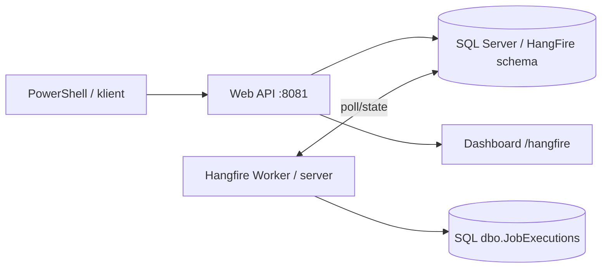

# Demonstracja 67 — Hangfire + SQL Server 2022

**WWSI | .NET 10 | EF Core / Microsoft.Data.SqlClient | Hangfire 1.8 | SQL Server 2022 | Docker Compose**

Nowa, niezależna od demonstracji 66 aplikacja do eksperymentów z zadaniami w tle. Rozdzieliliśmy proces API (producent jobów) i Worker (Hangfire BackgroundJobServer). Hangfire utrzymuje stan zadań w SQL Server; biznesowy rezultat zapisujemy w tabeli `dbo.JobExecutions`.

> Laboratorium, **nie konfiguracja produkcyjna**: panel Hangfire nie ma logowania (port jest przypięty do 127.0.0.1 na hoście), a konto `demo67_hangfire` jest członkiem `db_owner`, gdyż na starcie automatycznie instalujemy schemat Hangfire. Produkcja wymaga uwierzytelnienia panelu, osobnego provisioningu przez DBA, least privilege, TLS, monitoringu i backupów. Nie udostępniaj portu przez tunel ani reverse proxy.

## Architektura



## Wymagania i uruchomienie

Windows 11 / PowerShell 7, Docker Desktop (kontenery Linux), Docker Compose, .NET SDK 10, Git. **Dwa osobne porty** w stosunku do demonstracji 66: API `http://localhost:8081`, SQL `localhost,14354`; osobna baza `HangfireLab67` i wolumen `hangfire67_sql`.

W katalogu `demonstracje/67_HangfireSqlServer`:

```powershell
git pull
if (-not (Test-Path .env)) { Copy-Item .env.example .env }
notepad .env        # zmień przykładowe hasła
docker compose config --quiet
docker compose up -d sql
docker compose --profile setup run --rm db-init
docker compose up -d --build api worker
docker compose ps
.\scripts\Smoke-Test.ps1
```

SQL należy zostawić do osiągnięcia `healthy`, a `db-init` musi zakończyć się kodem 0. **Nie używaj `docker compose down -v`**, gdyż trwale usunie dane. Nie publikuj wyniku `docker compose config` bez `--quiet` — może zawierać hasła.

**Panel:** http://localhost:8081/hangfire. W nim widać Enqueued, Scheduled, Processing, Succeeded, Failed, Retries i Servers.

## Endpointy

| Metoda | Adres | Payload / cel |
|---|---|---|
| GET | `/health/live` | API alive |
| POST | `/jobs/fire` | `{"workSeconds":0}` — natychmiast |
| POST | `/jobs/delay` | `{"workSeconds":0,"delaySeconds":10}` — opóźnione |
| POST | `/jobs/continuation` | parent → child |
| POST | `/jobs/fail-once` | celowa pierwsza awaria; kolejna próba sukces |
| POST | `/jobs/recurring` | zadanie heartbeat co minutę |
| DELETE | `/jobs/recurring` | usuwa recurring job |
| GET | `/jobs/{id}` | stan i historia joba |
| GET | `/hangfire` | dashboard laboratoryjny |

## Ćwiczenia

1. **Fire-and-forget:** POST `/jobs/fire`; oczekuj Succeeded, w tabeli `dbo.JobExecutions` jeden efekt.
2. **Delayed:** POST `/jobs/delay`; oczekuj Scheduled → Enqueued → Processing → Succeeded (przejściowe stany mogą nie zostać zauważone w odpytywaniu).
3. **Continuation:** POST `/jobs/continuation`; poczekaj na zakończenie parent i child, sprawdź dwa biznesowe wpisy.
4. **Recurring:** POST `/jobs/recurring`, obserwuj heartbeat przez kilka minut, po czym DELETE. Hangfire recurring scheduler działa z dokładnością **minuty**, a nie milisekund.
5. **Worker offline:** `docker compose stop worker`; zleć kilka fire-and-forget; podczas przestoju pozostaną Enqueued; `docker compose start worker`, sprawdź Succeeded.
6. **Retry:** POST `/jobs/fail-once`; pierwsza próba rzuci celowy wyjątek, kolejne wykonanie powinno zakończyć się sukcesem. Domyślny backoff Hangfire może trwać dłużej niż smoke-test; obserwuj Failed/Scheduled oraz retry w panelu. Możesz ręcznie Requeue po pierwszej porażce.
7. **DBA:** obserwuj schemat `HangFire` w SQL, monitoruj kolejki, locki, liczbę jobów i historia stanów.
8. **Trwałość po restarcie:** zleć delayed job, zrestartuj API + Workera i potwierdź wykonanie; bez kasowania wolumenu SQL.

### Smoke-test

```powershell
.\scripts\Smoke-Test.ps1
```

Sprawdza fire-and-forget, delayed i continuation. Celowy retry i recurring są osobnymi ćwiczeniami (długie harmonogramy).

### Przykład PowerShell

```powershell
$base="http://localhost:8081"
$j=Invoke-RestMethod "$base/jobs/fire" -Method Post -Body '{"workSeconds":3}' -ContentType application/json
$j
Invoke-RestMethod "$base/jobs/$($j.jobId)"
Invoke-RestMethod "$base/jobs/recurring" -Method Post
# Po obserwacji:
Invoke-RestMethod "$base/jobs/recurring" -Method Delete
```

## Zapytania DBA (SSMS: localhost,14354)

```sql
USE HangfireLab67;
GO
SELECT TOP (50) Id, StateName, CreatedAt, ExpireAt
FROM HangFire.Job ORDER BY Id DESC;

SELECT TOP (50) JobId, Name, CreatedAt, Reason
FROM HangFire.State ORDER BY Id DESC;

SELECT TOP (50) RunKey, Kind, ExecutedAtUtc
FROM dbo.JobExecutions ORDER BY ExecutedAtUtc DESC;

SELECT TOP (50) RunKey, Attempts FROM dbo.JobAttempts ORDER BY Attempts DESC;

SELECT TOP (50) Id, JobId, Queue, FetchedAt FROM HangFire.JobQueue ORDER BY Id DESC;

SELECT TOP (50) Id, LastHeartbeat FROM HangFire.Server ORDER BY LastHeartbeat DESC;
```

## Ograniczenia

Hangfire zapewnia trwałe przechowywanie jobów i ich stanów, ale nie gwarantuje dokładnie jednokrotnego **wykonania** kodu. Zadanie może zostać ponowione np. po awarii Workera, dlatego `dbo.JobExecutions.RunKey` jest kluczem głównym, a metoda `ExecuteAsync` rejestruje efekt w transakcji z blokadami. Jest to **jedna konkretna idempotentna operacja demonstracyjna**, nie automatyczna idempotencja dowolnego kodu.

Dokumentacja oficjalna: https://docs.hangfire.io/en/latest/getting-started/aspnet-core-applications.html oraz https://docs.hangfire.io/en/latest/configuration/using-sql-server.html.
